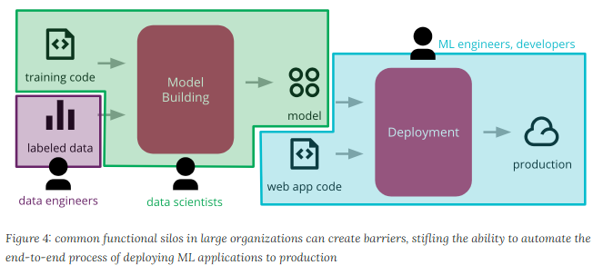

# CD4ML Concepts

**De onde veio:**
Material [CD4ML — Martin Fowler](https://martinfowler.com/articles/cd4ml.html)

**O que aprendi:**

Do mesmo jeito que versionamos código sendo desenvolvedor, ML versiona o modelo.

A imagem abaixo representa a organização do time:
 

 
Componentes CD4ML:

- **Manter dados acessível**: Quão mais fácil o dado estiver acessível e procurável pelo cientista, mais rápido é o desenvolvimento do modelo. Democratização dos dados no Data Mesh é nossa forma de implementação.
- **Modelo reproduzível**: Deve ser possível reproduzir o mesmo modelo dado os mesmos dados + código + configuração. O AWS Sage Maker é uma implementação dessa solução.
- **Model Layer**: \*\*continuar
